# Portfolio Tracker

[](https://github.com/eric-delope/portfolio-tracker/actions/workflows/ci.yml)


**Privacy-first, long-term portfolio analytics and entry planning for broker CSV exports – Trade Republic, Scalable Capital or any broker via a generic template. English or German UI.**

The broker app shows a balance and a line. This tool answers what a long-term investor actually needs to know
once a month: *How am I really doing against the market? Where is my risk – and what do I really own inside my ETFs?
Were my entries good – and does waiting for pullbacks even pay? Where can my saving plan lead? And what is the highest price I should pay for the next company
on my list?*

It is a Python package with a tested analytics core (performance, risk, ETF look-through, Monte Carlo planning,
German taxes, valuation, reverse DCF, guidance extraction) and a Streamlit dashboard on top. It runs on a synthetic demo portfolio out of the box.

> 🔒 **Your financial data never leaves your computer.** No account, no upload, no cloud. Names and IBANs are dropped
> on import, the only requests go out for public ticker prices – each one is logged in the app – and offline mode
> switches even those off. These guarantees are unit tests that run in CI. → [How privacy is enforced](docs/PRIVACY.md)

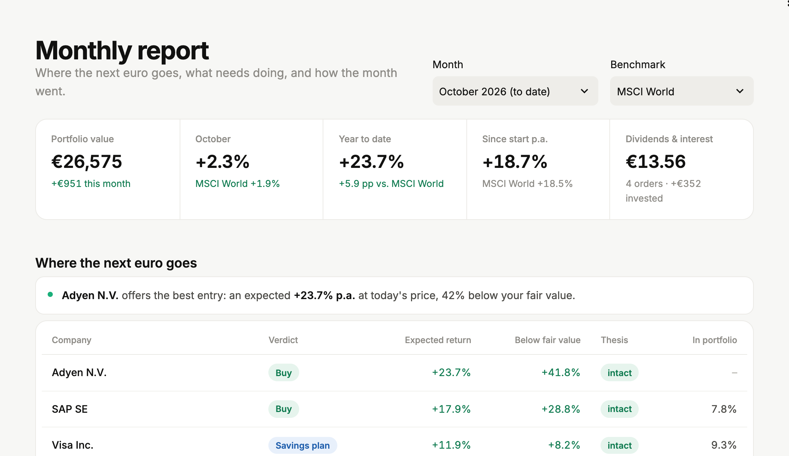

<details>
<summary>Dark mode</summary>

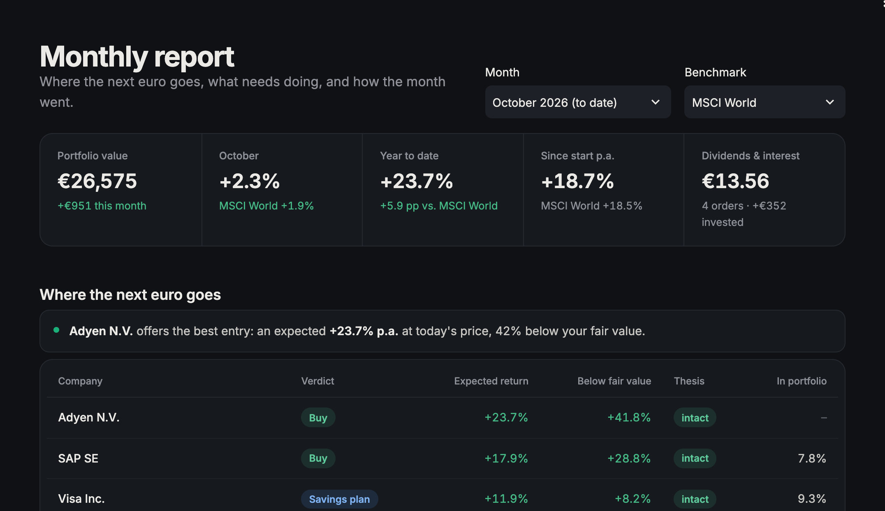
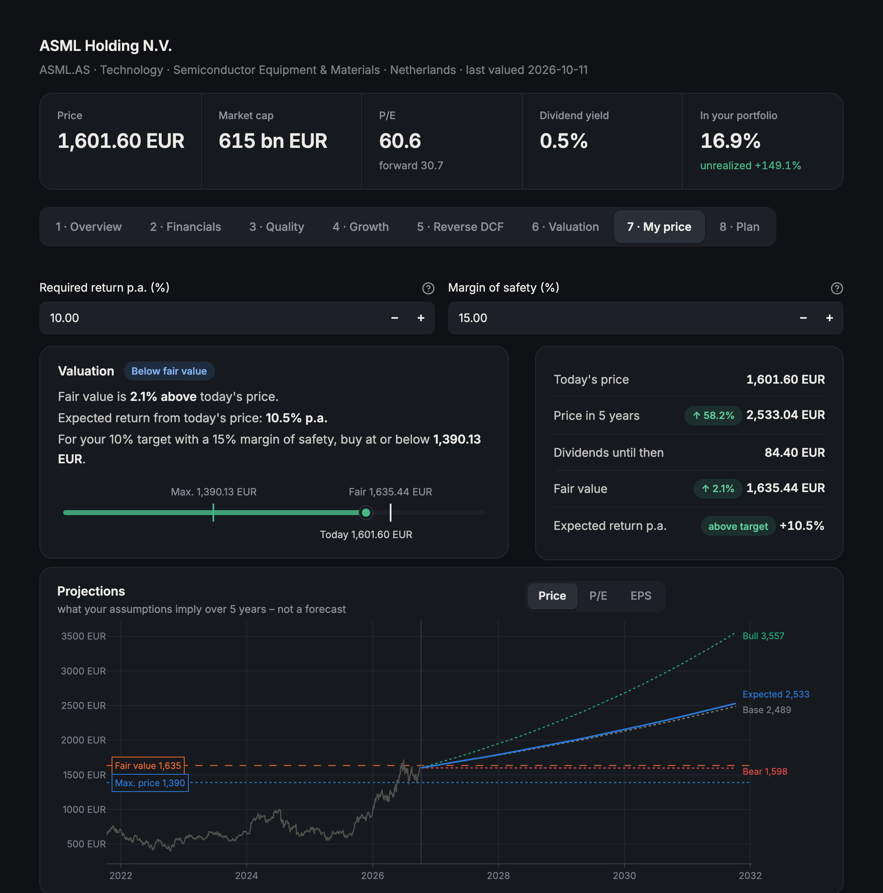
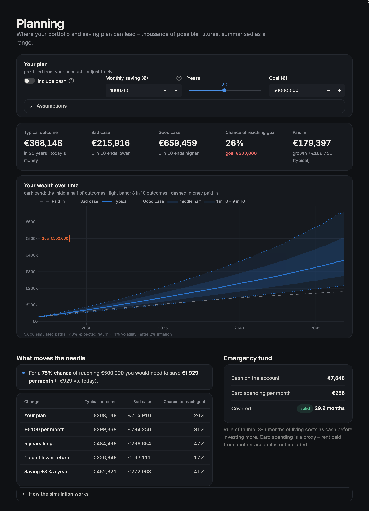

</details>

<details>
<summary>German interface (Deutsch)</summary>

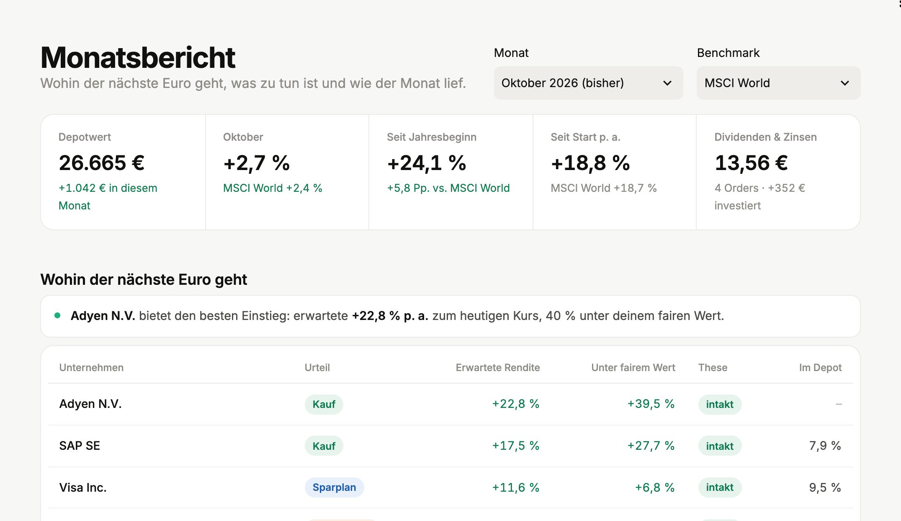
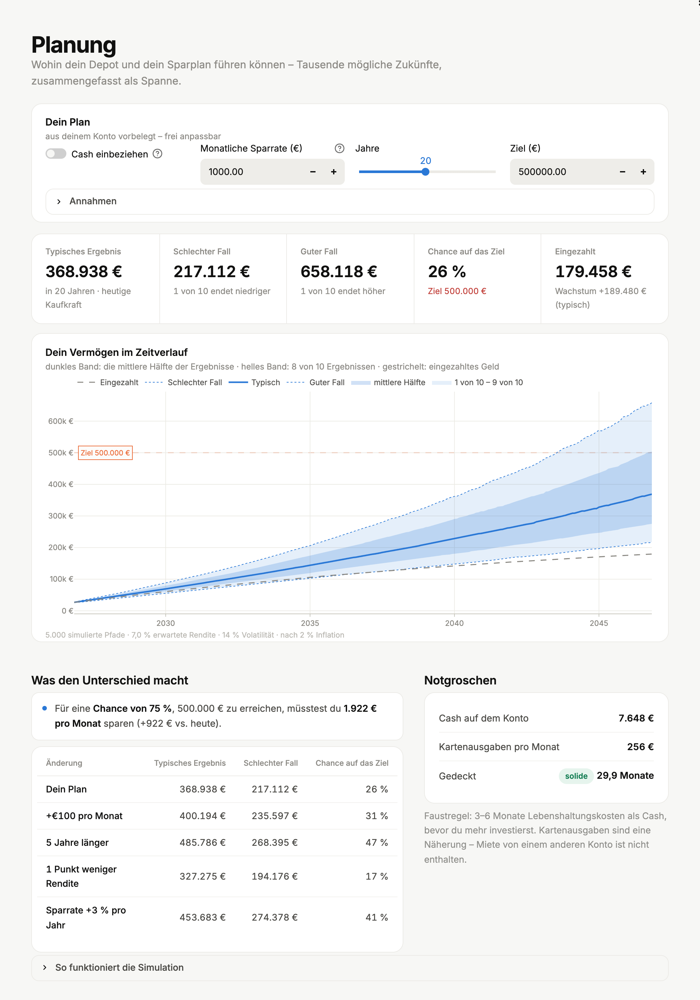

</details>

---

## Privacy first

Hosted portfolio trackers ask you to upload your complete financial history. This one is built the other way round:

| | |
|---|---|
| **Local processing** | The export is analysed on your machine; uploads stay in memory. No backend, no account. |
| **Data minimisation** | Counterparty names, IBANs, card merchants and references are removed on import – the analysis never sees them. |
| **Transparent network use** | Every outbound request passes one gate and is listed on the *Privacy & data* page: recipient, purpose, identifiers sent (public tickers only). |
| **Offline mode** | `PORTFOLIO_OFFLINE=1` blocks every request; the app runs from its local cache. |
| **No third parties in the browser** | Self-hosted font, telemetry off, dashboard bound to `localhost` – a headless browser audit saw no host but `localhost`. |
| **Safe to share** | Privacy mode hides every euro amount for screenshots; the public demo is synthetic. |
| **Verified, not promised** | Tests block all sockets for the analytics core, check that personal details never reach any output and scan every publishable file for exports, IBANs and e-mail addresses. |

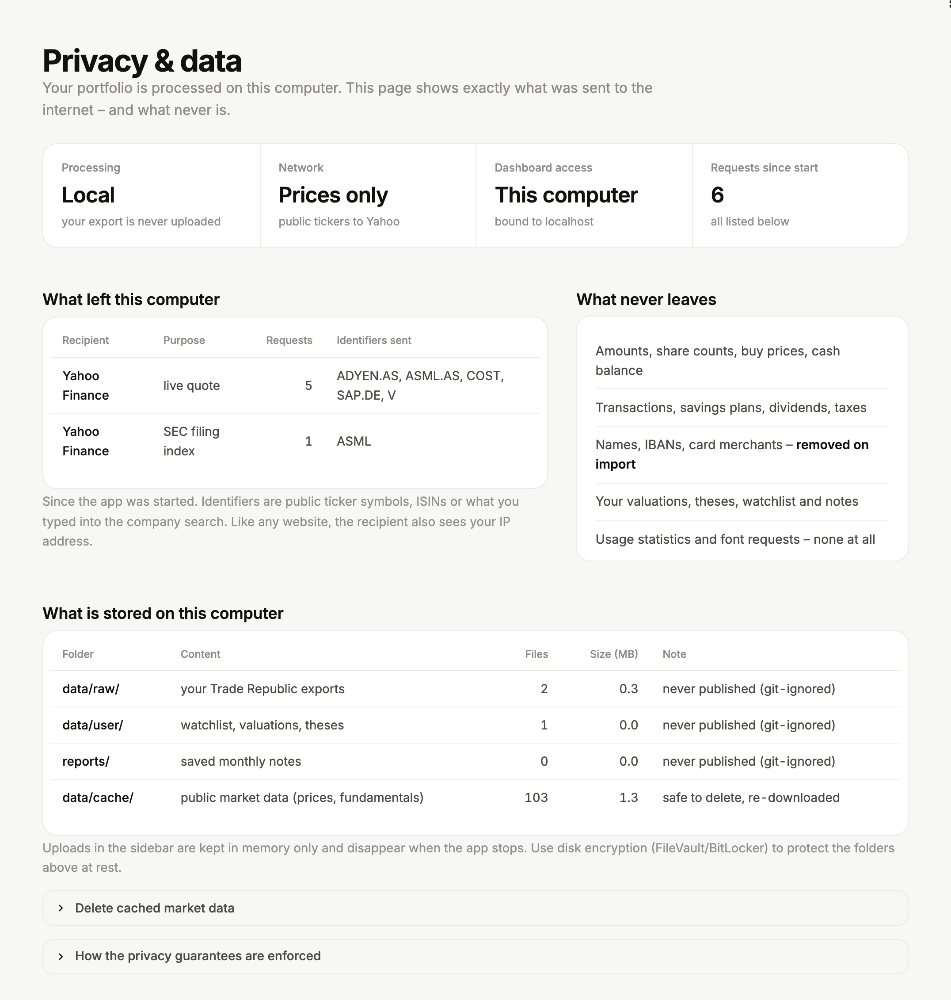

## What it does

| Page | Questions it answers |
|---|---|
| **Monthly report** | Where should the next euro go (entry ranking)? What needs doing (alerts reached, stale valuations, concentration, tax allowance)? What happened this month vs. the benchmark? Saves a Markdown note for an investment journal. |
| **Portfolio analysis** | Report in **euros or dollars** (converted at each day's rate). Time- and money-weighted returns, alpha/beta, shadow portfolio (PME), monthly heatmap, drawdowns, VaR/ES, risk contributions, correlations, stress tests, dividends, entry quality, decision scorecard, German taxes, cash flows and costs. **Look-through:** opens every ETF up to show what you really own – companies and sectors, direct plus through funds, and overlaps. |
| **Planning** | Where can today's portfolio and saving plan lead? 5,000 simulated futures as a range (bad / typical / good case), chance of reaching a goal, the monthly saving a 75% chance needs, what moves the needle (save more, longer, lower returns) – and an emergency-fund check. |
| **Watchlist & entries** | Every valued company ranked by expected return at today's price, verdict (*Buy / Buy (small) / Savings plan / Watch / Avoid*), price alerts that grow with fair value, thesis status, order check. **Does waiting pay?** – a backtest of buying on pullbacks vs. a plain monthly savings plan over every start month of the last ten years. |
| **Light & dark, English & German** | Follows the system appearance; switch under ⋮ → Settings. English or German interface with German number formats (1.234,56 €). Euros or dollars as reporting currency. |
| **Company research** | A guided 8-step valuation: business → financials → quality → growth (history vs. analysts vs. company guidance) → **reverse DCF** → exit multiple → *my maximum price* → entry plan. Exports a one-page **investment memo (PDF)**. |
| **Privacy & data** | What left this computer (recipient, purpose, identifiers), what never does, what is stored where, offline status – plus a button to delete cached market data. |

<table>
<tr>
<td width="50%">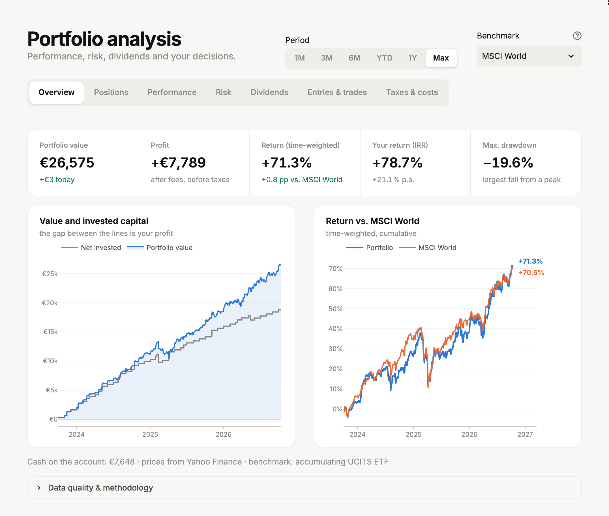<br><sub>Portfolio vs. invested capital and vs. MSCI World (time-weighted).</sub></td>
<td width="50%">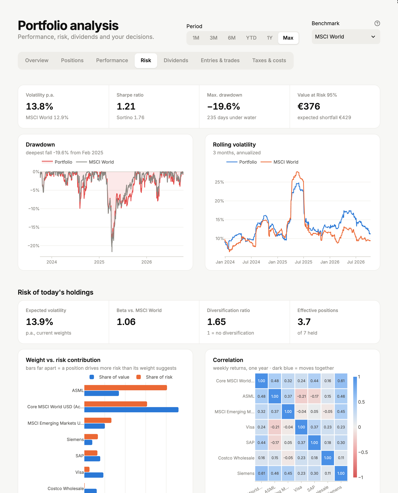<br><sub>Forward-looking risk: weight vs. risk contribution, correlations, VaR, stress tests.</sub></td>
</tr>
<tr>
<td>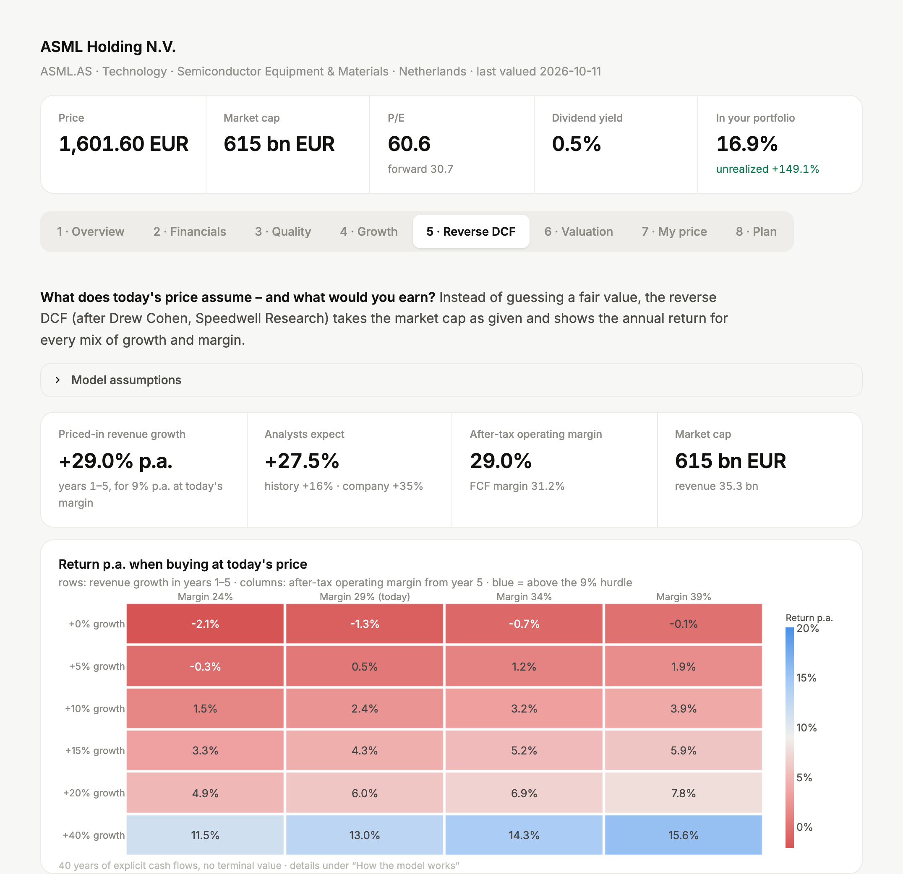<br><sub>Reverse DCF (Speedwell Research method): implied return for every growth × margin scenario at today's price.</sub></td>
<td>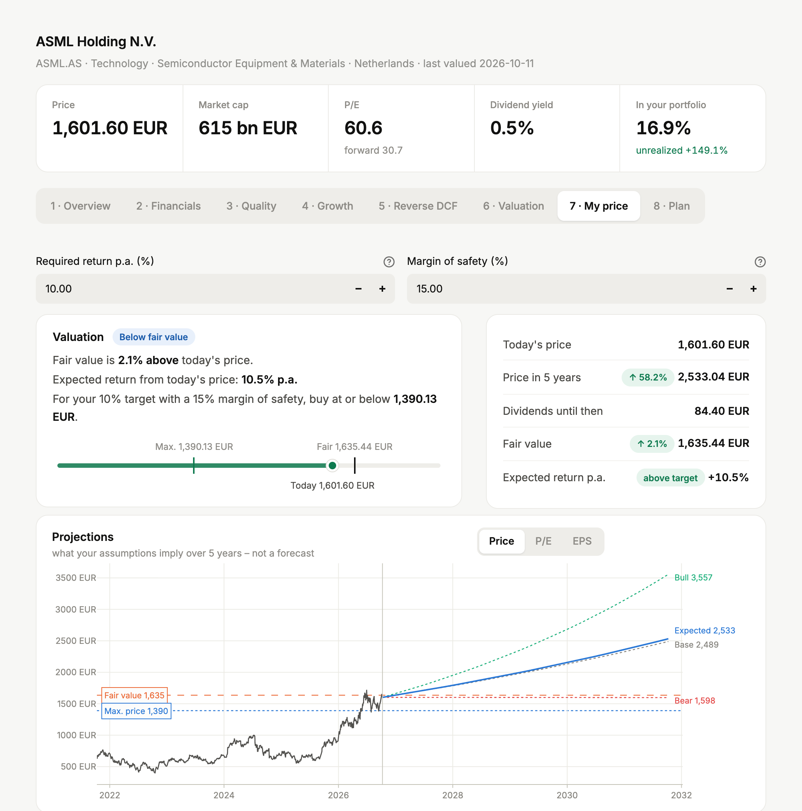<br><sub>Valuation summary, price-vs-value bar and projections (price, P/E vs. its median, EPS) for every scenario.</sub></td>
</tr>
<tr>
<td>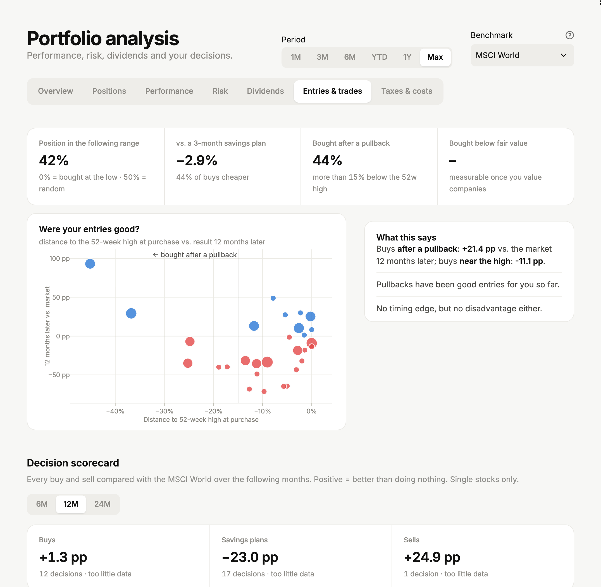<br><sub>Were my entries good? Buy price vs. the following range, after-pullback buys vs. near-high buys, scorecard vs. market.</sub></td>
<td>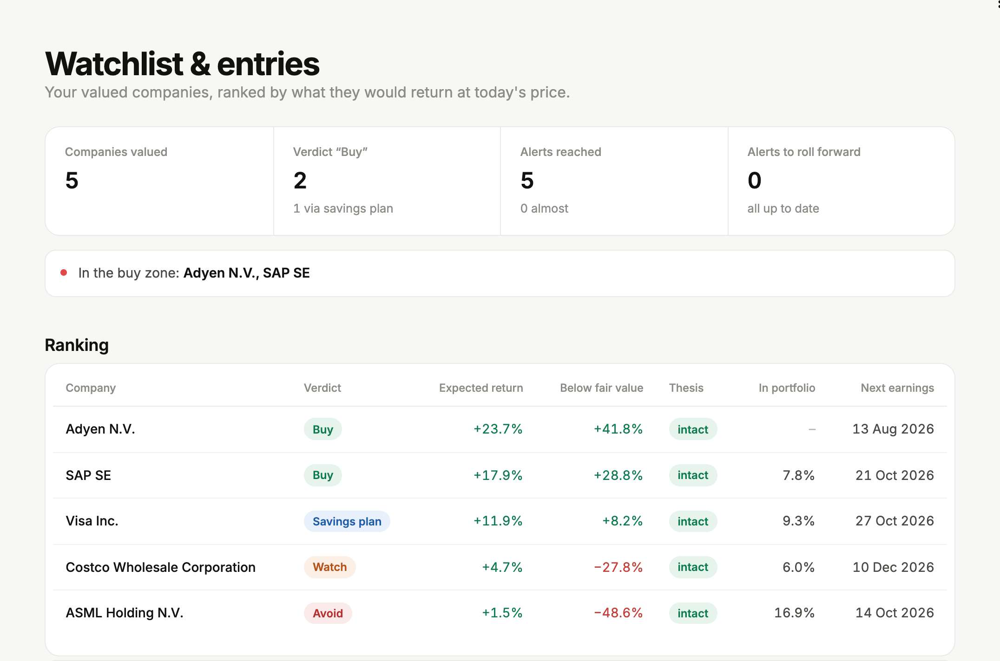<br><sub>Watchlist ranked by expected return; alerts in trading currency and EUR for the broker app.</sub></td>
</tr>
<tr>
<td>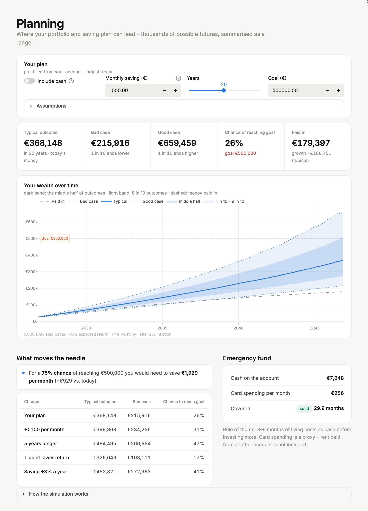<br><sub>Planning: 5,000 simulated futures as a range, chance of reaching a goal, what moves the needle, emergency fund.</sub></td>
<td>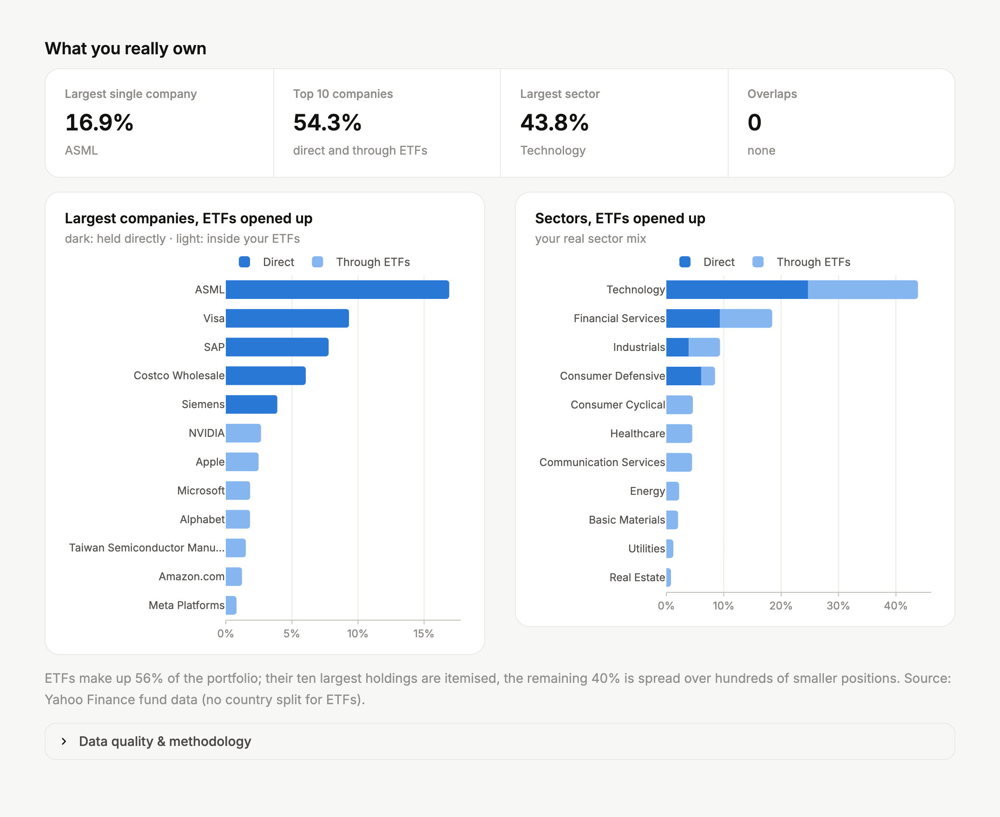<br><sub>What you really own: ETFs opened up into companies and sectors – direct and through funds.</sub></td>
</tr>
<tr>
<td colspan="2">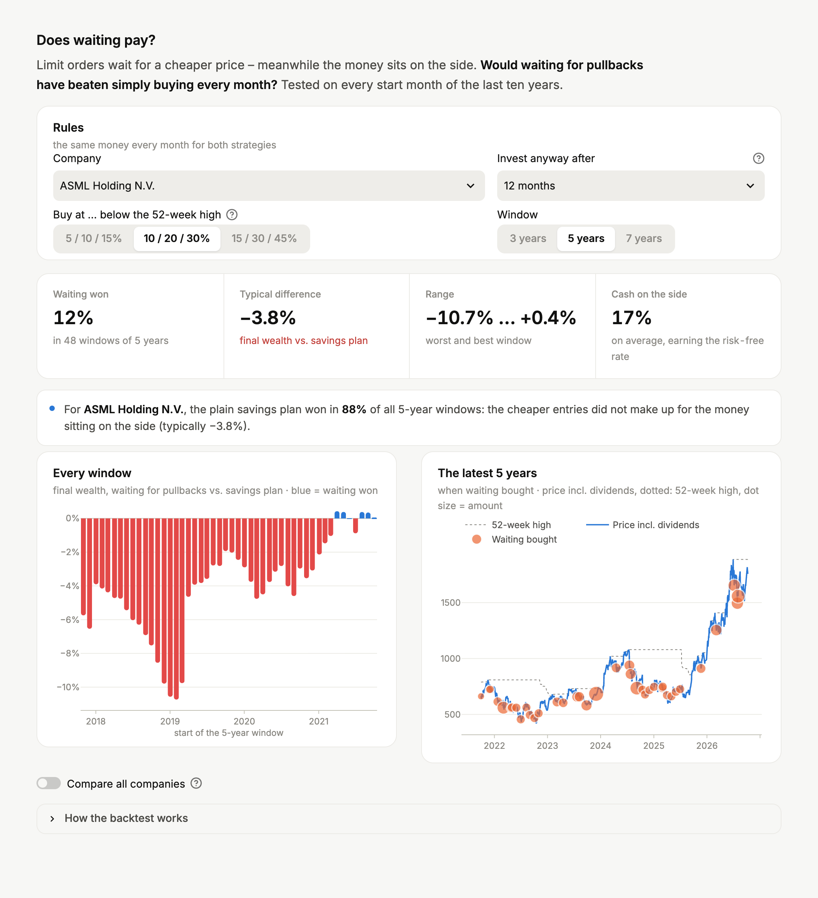<br><sub>Does waiting pay? Waiting for pullbacks vs. a monthly savings plan, tested on every 5-year window of the last ten years.</sub></td>
</tr>
<tr>
<td colspan="2">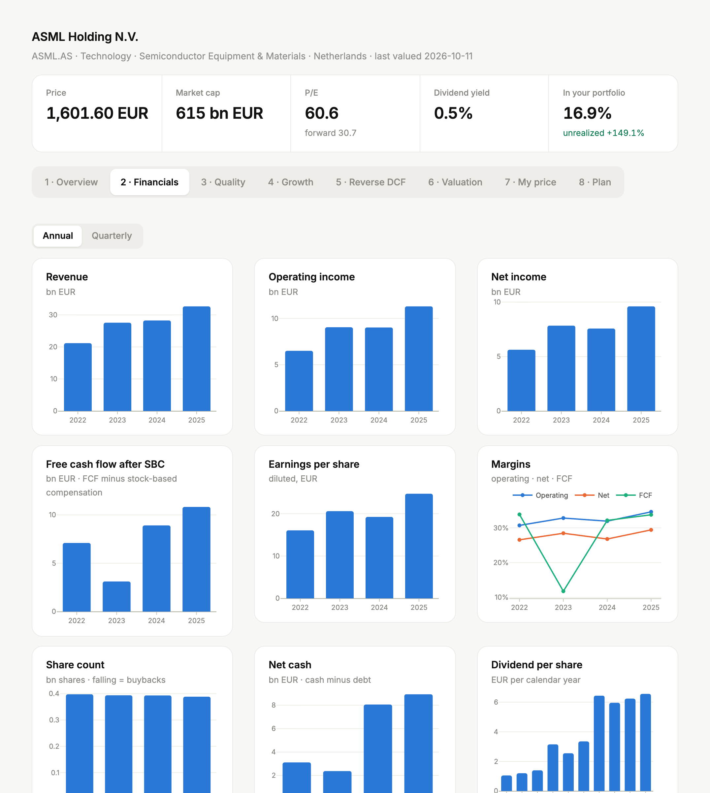<br><sub>Financials at a glance: revenue, earnings, SBC-adjusted free cash flow, margins, share count, valuation multiples and earnings surprises.</sub></td>
</tr>
</table>

📄 **Sample output:** [one-page investment memo (PDF)](docs/sample_memo.pdf) generated from the research page.

### Design principles

- **Long-term first.** No price targets or momentum signals. The sell discipline is valuation-based (expected return
  below a floor) or a broken thesis (KPIs re-checked after every report).
- **Entry discipline.** Fair value compounds with the required return, buy tranches grow with it, and each tranche
  shows its historical probability of being reached within 12 months.
- **Measure yourself.** Every buy and sell is scored against the benchmark 6/12/24 months later, with a significance
  verdict so luck isn't mistaken for skill.
- **Explainable numbers.** Every valuation is shown as a bridge (EPS → price in 5 years → discounted → minus margin of
  safety) and every chart states its source.

## Quickstart

> Supported exports and the generic template for any other broker: [docs/IMPORT_FORMATS.md](docs/IMPORT_FORMATS.md)

```bash
git clone https://github.com/eric-delope/portfolio-tracker.git
cd portfolio-tracker
python -m venv .venv && source .venv/bin/activate
pip install -r requirements.txt -e ".[dev]"
streamlit run app/dashboard.py
PORTFOLIO_OFFLINE=1 streamlit run app/dashboard.py   # no network at all (uses the cache of earlier runs)
```

Without data of your own the app starts in **demo mode** (force it with `PORTFOLIO_DEMO=1 streamlit run app/dashboard.py`): a synthetic three-year portfolio (monthly deposits, ETF
savings plans, a handful of quality stocks bought in tranches, one sale, dividends, card spending with Saveback)
built from **real historical prices**, plus a demo watchlist. Regenerate it with `python scripts/make_demo_data.py`.

**Your own portfolio:** in the Trade Republic app export your transactions as CSV and drop the file into `data/raw/`
(or upload it in the sidebar). The newest file is picked up automatically. Toggle **privacy mode** in the sidebar to
hide all euro amounts for screenshots.

```bash
pytest -q          # 133 tests: identities, solvers, parsers, tax rules, privacy guarantees, PDF export
ruff check .       # lint
python -m portfolio_tracker.alerts --notify   # check price alerts from the command line (macOS notification)
```

## Architecture

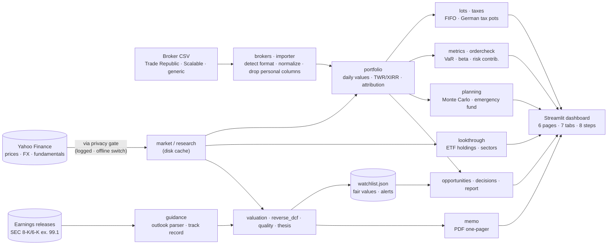

```
src/portfolio_tracker/   analytics core – no Streamlit imports, fully unit-tested
app/                     dashboard: dashboard.py (entry), common.py (state, formatting, tables), charts.py
app/views/               the six pages
app/sections/            one module per analysis tab / research step
scripts/                 demo data generator, i18n catalog check
app/locales/de.json      German translations (English texts in the code are translated where they are rendered)
docs/                    methodology, decision records, screenshots, sample memo
```

## Methodology & validation

The full write-up with formulas is in [docs/METHODOLOGY.md](docs/METHODOLOGY.md). In short:

- **Returns:** daily time-weighted return chained from `(V + outflows) / (V₋₁ + inflows) − 1`; money-weighted return
  as XIRR; periods under one year are not annualized (GIPS).
- **Benchmarks:** accumulating UCITS ETFs in EUR (MSCI World, S&P 500, Nasdaq-100), plus a shadow portfolio and the
  Kaplan-Schoar PME borrowed from private equity.
- **Risk:** beta and correlations on **weekly** returns (US closes are asynchronous to Xetra), historical VaR/ES,
  Euler risk contributions, effective number of positions, beta- and FX-based stress tests.
- **Valuation:** probability-weighted bear/base/bull EPS × exit P/E with consensus EPS for year 1 and dividends;
  buying at fair value earns exactly the required return by construction. Cross-checks: two-stage DCF and a
  **reverse DCF** after Speedwell Research (explicit 40-year cash flows, no terminal value, growth fading in buckets,
  normalized margin minus reinvestment via sales-to-capital).
- **Taxes (Germany):** FIFO, separate stock loss pot, 30% partial exemption for equity ETFs, saver's allowance,
  latent tax on unrealized gains.

**Validated by:** the portfolio value matches the broker's figure on a real export; accounting identities are tested
(P&L = value + outflows − inflows; realized + unrealized + dividends = total; monthly P&L sums to the total; monthly
TWRs compound to the full-period TWR; TWR is invariant to deposits); solvers are tested by round trip (XIRR,
reverse DCF implied growth, price-for-return); the guidance parser is tested on real press-release text.

## Project management

The project was built in short iterations, each driven by explicit user feedback – see the
[CHANGELOG](CHANGELOG.md) (v0.1 import → v1.0 public release), the [ROADMAP](ROADMAP.md) and the
[decision records](docs/decisions/) that document the non-obvious choices (weekly beta, normalized reverse DCF,
guidance source, privacy by design, long-term focus).

## Privacy

Details, data-flow diagram, enforcement and honest limits: [docs/PRIVACY.md](docs/PRIVACY.md).
Real exports, caches, the watchlist and generated reports are git-ignored (`data/raw/`, `data/cache/`, `data/user/`,
`reports/`).

## Disclaimer

This is a personal research tool, not investment, tax or legal advice. Market data comes from Yahoo Finance and may
be delayed, incomplete or wrong; tax figures are simplified estimates. Trade Republic is a trademark of Trade Republic
Bank GmbH; this project is not affiliated with or endorsed by it.

## License

[MIT](LICENSE)
