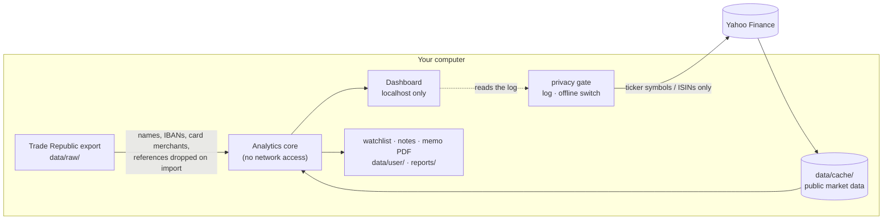

# Privacy

> **Principle:** a portfolio tracker needs your complete financial history. So it has to be built like a vault, not
> like a cloud service. Your data is processed on your computer, nothing personal is ever sent anywhere, and every
> request that does leave the machine is visible and can be switched off.


## Data flow



## What leaves your computer – and what never does

| Leaves (only when online) | Recipient | Why |
|---|---|---|
| Ticker symbols and ISINs of your holdings and watchlist | Yahoo Finance | prices, FX rates, fundamentals, dividends, ETF holdings and sectors (look-through) |
| Company names for non-US stocks (to find the US listing) | Yahoo Finance | SEC filing index for company guidance |
| What you type into the company search | Yahoo Finance | search results |
| Your IP address (as with any website) | Yahoo Finance | technical necessity of a request |

**Never leaves:** amounts, share counts, buy prices, cash balance, transactions, savings plans, dividends received,
taxes, names, IBANs, card merchants, payment references, your valuations, theses, watchlist and notes. Also not:
usage statistics (Streamlit telemetry is off) or requests to font or CDN servers (the font is self-hosted).

The browser was audited with a headless Chrome session across all pages: the only host it contacted was
`localhost`.

## How it is enforced

| Measure | Where | Verified by |
|---|---|---|
| Personal columns are dropped on import – they never reach the analysis | `importer.load_transactions` | `test_personal_columns_are_dropped`, `test_personal_data_never_reaches_any_output` |
| The analytics core has no network access | `src/portfolio_tracker/` gets data only through injected market-data objects | `test_analytics_core_works_without_network` (all sockets blocked) |
| One gate for every outbound request: logged, or blocked in offline mode | `privacy.network` | `test_offline_mode_blocks_every_request`, `test_request_log_shows_what_was_sent` |
| Offline mode works from the local cache, even if it is old | `PORTFOLIO_OFFLINE=1` | `test_offline_mode_prefers_stale_cache`, full UI sweep offline |
| Dashboard reachable from this computer only | `.streamlit/config.toml`: `address = "localhost"` | shown on the Privacy page |
| No third-party font or analytics requests | self-hosted Inter (SIL OFL), `gatherUsageStats = false` | browser network audit |
| Nothing personal can be published | `.gitignore` for `data/raw/`, `data/user/`, `data/cache/`, `reports/` | `test_repository_contains_no_personal_data` scans every publishable file for exports, IBANs and e-mail addresses |
| Safe screenshots and screen sharing | Privacy mode hides every euro amount and the tickers in the request log | manual + UI sweep with privacy mode on |
| Uploaded exports are never written to disk | held in memory for the session | code: `common.load` |
| The public demo contains no real person's data | synthetic transactions on real prices | `scripts/make_demo_data.py` |

All tests run in CI on every push.

## Offline mode

```bash
PORTFOLIO_OFFLINE=1 streamlit run app/dashboard.py
```

No request at all. Prices, FX rates, fundamentals, dividends and company guidance come from `data/cache/`
(whatever was last downloaded). Useful on untrusted networks, on the train, or when you simply do not want anyone
to learn which stocks you look at.

## Limits – stated honestly

- **When online, Yahoo learns which ticker symbols you request** – together with your IP address, that hints at
  what you hold or watch. It never learns amounts. If that matters, use offline mode after a fetch on a trusted
  connection, or a VPN.
- **Files at rest are not encrypted by the app.** Use the operating system's disk encryption (FileVault, BitLocker).
- **The Markdown notes and memo PDFs you save contain your figures** – they stay in `reports/` (git-ignored) unless
  you move them.
- The app is a single-user local tool. Exposing it on a network or hosting it with real data is out of scope; the
  public live demo runs on the synthetic portfolio only.

## Why this matters (GDPR context)

Under the GDPR, financial data and data revealing a person's habits (card payments) deserve the highest care, and
even an IP address is personal data – a German court fined a website for loading Google Fonts from Google's servers
(LG München I, 20 Jan 2022, 3 O 17493/20). This project therefore applies *data minimisation* (only public
identifiers are ever transmitted), *privacy by default* (local processing, localhost binding, no telemetry) and
*transparency* (every request is listed in the app). See also
[decision record 0005](decisions/0005-privacy-by-design.md).
